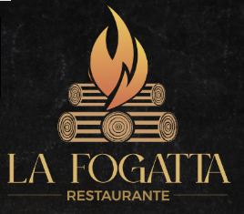
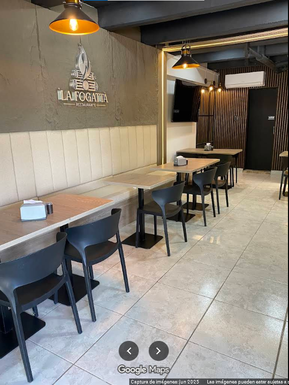
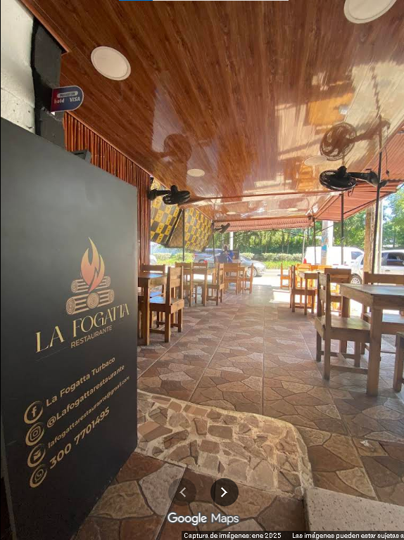

# DESIGN.md — La Fogatta Restaurante
## Sistema Visual · Identidad Carbón/Dorado/Brasa

---

## 1. Concepto de Marca

La Fogatta es una parrilla artesanal en Turbaco, Bolívar. Todo se cocina al carbón. No es un restaurante genérico ni una franquicia — es una institución local donde el fuego es el protagonista. El carbón, la brasa, el humo y el calor definen tanto la cocina como la identidad visual. El lugar vive en dos tiempos: el día de las familias, los sancochos de caldero y los asados lentos; la noche de las hamburguesas premium, los perros artesanales y los cortes a la brasa.

La identidad visual traduce ese dualismo: oscuridad dominante y destellos dorados. La landing no es una página informativa — es una experiencia inmersiva que huele a carbón y sabe a fuego. Cada sección debe sentirse como entrar más adentro del restaurante, con profundidad creciente y momentos visuales que sorprendan.

**Tagline oficial:** Artesanales de Tradición
**Subtítulo de posicionamiento:** Parrilla al Carbón · Turbaco · Colombia
**Personalidad de marca:** Caliente, profundo, artesanal. El lugar que no necesita explicarse — se siente.

**Referente de estructura:** atrium.com.co pero más oscuro, más fuego, más profundidad visual. Cada sección es una experiencia, no un bloque de contenido.

---

## 2. Paleta de Color

### 2.1 Colores base

| Token CSS | Nombre | Hex | Rol principal |
|---|---|---|---|
| `--color-negro` | Negro profundo | `#0D0D0D` | Fondo dominante, superficies principales |
| `--color-carbon` | Carbón | `#1A1A1A` | Fondos secundarios, cards, footer |
| `--color-dorado` | Dorado cálido | `#D4A017` | Logo, títulos de sección, acentos activos |
| `--color-ambar` | Ámbar llama | `#E8850A` | Precios, detalles de fuego, CTAs secundarios |
| `--color-crema` | Crema cálida | `#F2EDE0` | Texto sobre fondos oscuros, cuerpo de texto |

**Reglas absolutas:**
- Nunca `#FFFFFF` puro. Nunca `#000000` puro. Nunca gris frío. Nunca ningún azul.
- Todo "negro" es `#0D0D0D`. Todo "blanco" es `#F2EDE0`.
- El dorado nunca se usa sobre fondo claro — solo sobre carbón o negro.
- El ámbar es el color del fuego: precios, badges de categoría, líneas calientes.

### 2.2 Familias derivadas — Negro/Carbón

```css
--color-negro-950: #050505;   /* Casi negro absoluto, solo para sombras */
--color-negro-900: #0D0D0D;   /* BASE — color-negro, fondo dominante */
--color-negro-800: #141414;   /* Variación ligerísima de fondo */
--color-negro-700: #1A1A1A;   /* BASE — color-carbon, fondos secundarios */
--color-negro-600: #232323;   /* Fondos de cards en hover */
--color-negro-500: #2E2E2E;   /* Bordes sobre carbón */
--color-negro-400: #3D3D3D;   /* Bordes sutiles, separadores */
--color-negro-300: #555555;   /* Texto placeholder, íconos inactivos */
--color-negro-200: #777777;   /* Texto terciario sobre oscuro */
--color-negro-100: #9E9E9E;   /* Texto secundario, captions */
--color-negro-50:  #C4C4C4;   /* Texto meta, labels deshabilitados */
```

### 2.3 Familias derivadas — Dorado

```css
--color-dorado-900: #3D2900;   /* Sombras doradas profundas */
--color-dorado-800: #6B4800;   /* Dorado muy oscuro */
--color-dorado-700: #9B6800;   /* Dorado profundo */
--color-dorado-600: #C48A0A;   /* Dorado oscurecido */
--color-dorado-500: #D4A017;   /* BASE — color-dorado */
--color-dorado-400: #DDB53A;   /* Dorado suavizado */
--color-dorado-300: #E6C96A;   /* Dorado claro, texto sobre muy oscuro */
--color-dorado-200: #EFDC9F;   /* Dorado muy suave, backgrounds de badge */
--color-dorado-100: #F7EDD0;   /* Dorado casi invisible, hover suave */
--color-dorado-50:  #FBF5E8;   /* Brillo dorado residual */
```

### 2.4 Familias derivadas — Ámbar

```css
--color-ambar-900: #3D1C00;   /* Sombras ámbar profundas */
--color-ambar-800: #6B3200;   /* Ámbar muy oscuro */
--color-ambar-700: #A84E00;   /* Ámbar profundo */
--color-ambar-600: #C86800;   /* Ámbar oscurecido */
--color-ambar-500: #E8850A;   /* BASE — color-ambar */
--color-ambar-400: #EE9B35;   /* Ámbar suavizado */
--color-ambar-300: #F3B568;   /* Ámbar claro */
--color-ambar-200: #F8CE9C;   /* Ámbar muy claro */
--color-ambar-100: #FBE4C8;   /* Ámbar casi invisible */
--color-ambar-50:  #FDF2E4;   /* Brillo ámbar residual */
```

### 2.5 Familias derivadas — Crema

```css
--color-crema-950: #1A1208;   /* Texto oscuro intenso sobre crema */
--color-crema-900: #2E2010;   /* Texto oscuro sobre crema */
--color-crema-800: #4A3420;   /* Texto medio oscuro */
--color-crema-700: #6B5030;   /* Texto terciario sobre crema */
--color-crema-600: #8A6A45;   /* Texto meta, etiquetas */
--color-crema-500: #AB8C68;   /* Bordes cálidos */
--color-crema-400: #C9AA8A;   /* Bordes muy suaves */
--color-crema-300: #E0CCB0;   /* Fondos de tarjeta sobre crema */
--color-crema-200: #EDE4D2;   /* Crema media */
--color-crema-100: #F2EDE0;   /* BASE — color-crema */
--color-crema-50:  #F8F4EC;   /* Crema casi blanca */
```

### 2.6 Colores funcionales

```css
--color-whatsapp:        #25D366;
--color-whatsapp-dark:   #1DA851;
--color-success:         #2D8A5F;
--color-error:           #C84B4B;

/* Overlays de fotografía */
--color-overlay-negro:   rgba(13, 13, 13, 0.60);    /* Hero overlay estándar */
--color-overlay-negro-deep: rgba(13, 13, 13, 0.75); /* Cards de platos overlay */
--color-overlay-ambar:   rgba(232, 133, 10, 0.15);  /* Hover cálido en galería */

/* Glow del ember (brasa) */
--color-ember-glow:      rgba(212, 160, 23, 0.30);  /* Resplandor dorado en hover */
--color-ember-glow-hot:  rgba(232, 133, 10, 0.35);  /* Resplandor ámbar intenso */
--color-ember-glow-soft: rgba(212, 160, 23, 0.15);  /* Resplandor suave ambiental */

/* Líneas y divisores */
--color-dorado-line:     rgba(212, 160, 23, 0.35);  /* Líneas doradas finas */
--color-ambar-line:      rgba(232, 133, 10, 0.30);  /* Líneas ámbar */

/* Sombras */
--color-shadow-dark:     rgba(5, 5, 5, 0.70);       /* Sombra profunda */
--color-shadow-medium:   rgba(5, 5, 5, 0.45);       /* Sombra media */
--color-shadow-light:    rgba(5, 5, 5, 0.20);       /* Sombra suave */
--color-shadow-gold:     rgba(212, 160, 23, 0.25);  /* Sombra dorada en cards */
```

---

## 3. Tipografía

### 3.1 Familias

**Display / Títulos principales:** `Oswald`
- Pesos: 700, 900
- Carácter: sans condensada bold, geométrica, impactante. Mayúsculas naturales con letter-spacing ajustado. Comunica fuerza, tradición industrial, carácter. Diferente de Cormorant (Carly's), Playfair+Dancing (Wakava) — Oswald es la voz del fuego: directa, densa, caliente.
- Uso: H1 hero, títulos de sección en mayúsculas, nombre "LA FOGATTA" en el logo, tabs de carta.

**Acento / Momentos cálidos:** `Playfair Display`
- Peso: 400 italic, 700 italic
- Carácter: serif clásico en cursiva. Contraste con la contundencia de Oswald — representa la tradición artesanal, la calidez familiar. Se usa en momentos específicos: tagline "Artesanales de Tradición", subtítulos de sección que necesitan calidez, descripciones poéticas.
- Uso: tagline hero, subtítulo hero, eyebrows de sección que evocan calor y tradición.

**Cuerpo / UI:** `DM Sans`
- Pesos: 400, 500, 600
- Carácter: sans humanista limpia y legible. Funciona a cualquier tamaño sobre fondo oscuro. Sin los defectos de Inter en tamaños pequeños.
- Uso: cuerpo de texto, navegación, precios, descripciones de platos, botones, metadatos.

### 3.2 Google Fonts — embed único

```html
<link rel="preconnect" href="https://fonts.googleapis.com">
<link rel="preconnect" href="https://fonts.gstatic.com" crossorigin>
<link href="https://fonts.googleapis.com/css2?family=DM+Sans:wght@400;500;600&family=Oswald:wght@700;900&family=Playfair+Display:ital,wght@1,400;1,700&display=swap" rel="stylesheet">
```

### 3.3 Escala tipográfica fluida

```css
/* Display — Oswald */
--text-display-xl: clamp(3.5rem, 9vw + 0.5rem, 8rem);   /* H1 hero — impacto máximo */
--text-display-lg: clamp(2.5rem, 5vw + 0.75rem, 5rem);  /* H2 secciones */
--text-display-md: clamp(1.75rem, 3vw + 0.5rem, 3rem);  /* H3 subsecciones */
--text-display-sm: clamp(1.25rem, 2vw + 0.25rem, 1.875rem); /* H4 */

/* Acento — Playfair Display italic */
--text-acento-xl: clamp(1.75rem, 3.5vw + 0.5rem, 3.25rem);  /* Tagline hero */
--text-acento-lg: clamp(1.375rem, 2.5vw + 0.25rem, 2.25rem); /* Subtítulo hero */
--text-acento-md: clamp(1.125rem, 1.5vw + 0.125rem, 1.625rem); /* Eyebrows de sección */

/* Cuerpo — DM Sans */
--text-body-xl:  1.25rem;    /* Lead / intro texto */
--text-body-lg:  1.125rem;   /* Texto principal */
--text-body-md:  1rem;       /* Base */
--text-body-sm:  0.9rem;     /* Secundario, captions */
--text-body-xs:  0.8rem;     /* Meta, badges, labels */

/* UI */
--text-ui-nav:   0.875rem;   /* Nav links */
--text-ui-btn:   0.9375rem;  /* Texto de botones */
--text-ui-label: 0.75rem;    /* Labels de tabs, formularios */
--text-ui-price: 1.125rem;   /* Precios en cards */
--text-ui-badge: 0.6875rem;  /* Badges de categoría */
```

### 3.4 Line heights y letter spacing

```css
--lh-tight:   1.05;  /* Títulos Oswald display grandes — muy condensado */
--lh-snug:    1.2;   /* Títulos medianos */
--lh-normal:  1.45;  /* Cuerpo de texto */
--lh-relaxed: 1.65;  /* Descripciones largas */

--ls-tightest: -0.04em;  /* Oswald display XL — compensar kerning */
--ls-tight:    -0.02em;  /* Oswald display LG */
--ls-snug:     -0.01em;  /* Oswald MD */
--ls-normal:   0;        /* Cuerpo DM Sans */
--ls-wide:     0.06em;   /* Labels uppercase DM Sans */
--ls-wider:    0.12em;   /* Eyebrows, badges */
--ls-widest:   0.18em;   /* Logo "RESTAURANTE" subtítulo */
--ls-oswald:   0.08em;   /* Oswald en uso nav — espacio intencional */
```

---

## 4. Espaciado y Layout

### 4.1 Escala de espaciado

```css
--space-1:  0.25rem;   /*  4px */
--space-2:  0.5rem;    /*  8px */
--space-3:  0.75rem;   /* 12px */
--space-4:  1rem;      /* 16px */
--space-5:  1.25rem;   /* 20px */
--space-6:  1.5rem;    /* 24px */
--space-8:  2rem;      /* 32px */
--space-10: 2.5rem;    /* 40px */
--space-12: 3rem;      /* 48px */
--space-16: 4rem;      /* 64px */
--space-20: 5rem;      /* 80px */
--space-24: 6rem;      /* 96px */
--space-32: 8rem;      /* 128px */
```

### 4.2 Padding de sección

```css
--section-py: clamp(4.5rem, 9vw, 8rem);     /* Padding vertical secciones oscuras */
--section-px: clamp(1.25rem, 5vw, 3.5rem);  /* Padding horizontal */
```

### 4.3 Contenedores

```css
--container-max:    1200px;
--container-wide:   1440px;
--container-narrow: 720px;
```

### 4.4 Border radius

```css
--radius-sm:   3px;
--radius-md:   6px;
--radius-lg:   10px;
--radius-xl:   16px;
--radius-2xl:  24px;
--radius-full: 9999px;
```

Las cards de platos sobre fondo oscuro usan radios mínimos (`--radius-md`) para mantener una estética de bloque industrial. No hay formas redondeadas excesivas — el diseño es angular y caliente.

---

## 5. Sombras

```css
--shadow-sm:         0 1px 4px var(--color-shadow-light);
--shadow-md:         0 4px 16px var(--color-shadow-medium), 0 2px 6px var(--color-shadow-light);
--shadow-lg:         0 12px 36px var(--color-shadow-dark), 0 4px 10px var(--color-shadow-medium);
--shadow-xl:         0 24px 60px var(--color-shadow-dark);

/* Sombras con calor */
--shadow-ember:      0 0 20px var(--color-ember-glow), 0 0 40px var(--color-ember-glow-soft);
--shadow-ember-hot:  0 0 30px var(--color-ember-glow-hot), 0 8px 24px var(--color-shadow-dark);
--shadow-gold-card:  0 4px 24px var(--color-shadow-gold), 0 2px 8px var(--color-shadow-light);
--shadow-gold-hover: 0 8px 40px var(--color-ember-glow), 0 0 60px var(--color-ember-glow-soft), 0 4px 16px var(--color-shadow-dark);

--shadow-card:       0 2px 16px var(--color-shadow-medium), 0 1px 4px var(--color-shadow-light);
--shadow-card-hover: 0 8px 32px var(--color-shadow-dark), 0 2px 8px var(--color-shadow-medium);
```

---

## 6. Transiciones y Animaciones

```css
--transition-fast:   150ms ease;
--transition-base:   280ms ease;
--transition-slow:   480ms ease;
--transition-reveal: 640ms cubic-bezier(0.22, 0.61, 0.36, 1);
--transition-glow:   320ms ease-out;   /* Para efectos de ember glow en hover */
```

**Principio de animación:** CSS primero. JS solo para IntersectionObserver, tabs y lógica de scroll. Sin GSAP ni librerías externas.

**Parallax hero:** Implementado con `transform: translateY()` vía JS escuchando `scroll` con `requestAnimationFrame`. El fondo de la foto se mueve al 40% de la velocidad del scroll (factor 0.4). La capa de texto se mueve al 20% (factor 0.2). Desactivado cuando `prefers-reduced-motion: reduce`.

**Grain/noise overlay:**
- Elemento `.hero__grain` con `position: absolute; inset: 0; pointer-events: none`
- `background-image: url("data:image/svg+xml,...")` — SVG de ruido generado inline o imagen PNG tileada de 200x200px de ruido estático
- `opacity: 0.04` (4%) — perceptible pero no dominante
- `mix-blend-mode: overlay`
- Aplicado también en fondos oscuros de secciones clave: `--noise-opacity: 0.03`

**Scroll reveal — clase `.reveal`:**
- Estado inicial: `opacity: 0; transform: translateY(28px);`
- Estado visible (`.is-visible`): `opacity: 1; transform: none;`
- Duración: `var(--transition-reveal)`
- Delays escalonados en grids: `animation-delay: calc(var(--reveal-index, 0) * 80ms)`
- IntersectionObserver con `threshold: 0.1` y `rootMargin: '0px 0px -60px 0px'`

**Ember glow en cards:**
- En hover: `box-shadow: var(--shadow-gold-hover); transform: scale(1.03);`
- Transición: `var(--transition-glow)` para el glow, `var(--transition-base)` para scale y translate
- La imagen interior hace `transform: scale(1.06)` en hover

---

## 7. Detalle de Marca — Borde Brasa (Ember Border)

El elemento visual distintivo de La Fogatta es el **borde brasa**: una línea de un solo píxel de grosor que emite un resplandor dorado-ámbar como si fuera brasa viva. Se implementa con `::after` usando `box-shadow` exterior y un gradiente de color que va de dorado a ámbar. Este borde no es decorativo — es la firma visual de la marca, equivalente a los marcos geométricos de Wakava.

### 7.1 Especificación técnica — Borde Brasa estándar

```css
.ember-border {
  position: relative;
}

.ember-border::after {
  content: '';
  position: absolute;
  inset: 0;
  border: 1px solid var(--color-dorado-500);
  border-radius: inherit;
  pointer-events: none;
  box-shadow:
    0 0 8px var(--color-ember-glow),
    inset 0 0 8px var(--color-ember-glow-soft);
  opacity: 0;
  transition: opacity var(--transition-glow);
}

.ember-border:hover::after,
.ember-border.is-active::after {
  opacity: 1;
}
```

### 7.2 Variante — Borde brasa siempre visible (secciones hero, cards estrella)

```css
.ember-border--always::after {
  opacity: 0.6;
}

.ember-border--always:hover::after {
  opacity: 1;
  box-shadow:
    0 0 16px var(--color-ember-glow),
    0 0 32px var(--color-ember-glow-soft),
    inset 0 0 12px var(--color-ember-glow-soft);
}
```

### 7.3 Variante — Línea brasa inferior (tabs activos, nav activo)

```css
.ember-line {
  position: relative;
}

.ember-line::after {
  content: '';
  position: absolute;
  bottom: -2px;
  left: 0;
  right: 0;
  height: 2px;
  background: linear-gradient(
    90deg,
    transparent 0%,
    var(--color-dorado-500) 30%,
    var(--color-ambar-500) 60%,
    transparent 100%
  );
  box-shadow: 0 0 8px var(--color-ember-glow);
  border-radius: 2px;
}
```

### 7.4 Variante — Glow de botón CTA principal

```css
.btn--brasa {
  position: relative;
  overflow: visible;
}

.btn--brasa::before {
  content: '';
  position: absolute;
  inset: -2px;
  border-radius: inherit;
  background: linear-gradient(
    135deg,
    var(--color-dorado-500) 0%,
    var(--color-ambar-500) 100%
  );
  opacity: 0;
  filter: blur(8px);
  z-index: -1;
  transition: opacity var(--transition-glow);
}

.btn--brasa:hover::before {
  opacity: 0.5;
}
```

### 7.5 Tamaños del borde brasa

```css
--ember-glow-sm:  4px;    /* Tabs, badges pequeños */
--ember-glow-md:  8px;    /* Cards estándar */
--ember-glow-lg:  16px;   /* Cards estrella, hero frame */
--ember-glow-xl:  32px;   /* Elementos hero, secciones de impacto */
--ember-thickness: 1px;   /* Grosor del borde siempre 1px */
```

---

## 8. Separadores de Sección y Fundidos

Para crear profundidad y fundir las fotos full-bleed con los fondos oscuros circundantes, cada sección con fotografía usa gradientes de fusión en sus bordes superior e inferior.

```css
/* Fundido superior — de negro a transparente */
.section-fade-top::before {
  content: '';
  position: absolute;
  top: 0;
  left: 0;
  right: 0;
  height: clamp(80px, 12vw, 160px);
  background: linear-gradient(
    to bottom,
    var(--color-negro) 0%,
    transparent 100%
  );
  z-index: 2;
  pointer-events: none;
}

/* Fundido inferior — de transparente a negro */
.section-fade-bottom::after {
  content: '';
  position: absolute;
  bottom: 0;
  left: 0;
  right: 0;
  height: clamp(80px, 12vw, 160px);
  background: linear-gradient(
    to top,
    var(--color-negro) 0%,
    transparent 100%
  );
  z-index: 2;
  pointer-events: none;
}
```

Aplicar `.section-fade-top` y `.section-fade-bottom` en: sección Dos Momentos, sección Galería, sección Platos Estrella.

---

## 9. Componentes — Especificación Detallada

### 9.1 Header

**Estructura HTML:**
```
<header id="header">
  ├── .header__brand
  │     ├── .header__logo-name ("LA FOGATTA" — Oswald 700)
  │     └── .header__logo-sub ("RESTAURANTE" — DM Sans 500 uppercase)
  ├── <nav class="header__nav">
  │     ├── <a class="header__nav-link" href="#menu">Menú</a>
  │     ├── <a class="header__nav-link" href="#nosotros">Nosotros</a>
  │     ├── <a class="header__nav-link" href="#galeria">Galería</a>
  │     └── <a class="header__nav-link" href="#ubicacion">Ubicación</a>
  ├── .header__actions
  │     ├── <a id="header-whatsapp-link"> "Pedir" — desktop
  │     └── <button id="menu-toggle"> — hamburguesa móvil
  └── <div id="mobile-menu" aria-hidden="true">
        ├── .mobile-menu__header (logo + botón cerrar)
        ├── <nav class="mobile-menu__nav">
        │     ├── <a class="mobile-menu__link" href="#menu">Menú</a>
        │     ├── <a class="mobile-menu__link" href="#nosotros">Nosotros</a>
        │     ├── <a class="mobile-menu__link" href="#galeria">Galería</a>
        │     └── <a class="mobile-menu__link" href="#ubicacion">Ubicación</a>
        └── <a id="mobile-whatsapp-link"> CTA WhatsApp
```

**Estados del header:**
- **Default (top):** `background: transparent`, sin blur. Logo y nav en crema. Sin borde inferior.
- **Scrolled (scrollY > 60):** Clase `.header--scrolled` añadida por JS.
  - `background: rgba(13, 13, 13, 0.92)`
  - `backdrop-filter: blur(16px) saturate(1.4)`
  - `border-bottom: 1px solid var(--color-dorado-line)`

**Tipografía del logo:**
- "LA FOGATTA" — Oswald 700, `clamp(1.25rem, 2.5vw, 1.75rem)`, color dorado `--color-dorado`, letter-spacing `var(--ls-oswald)`, uppercase.
- "RESTAURANTE" — DM Sans 500, `0.6rem`, letter-spacing `var(--ls-widest)`, color crema `rgba(242,237,224,0.6)`, uppercase, block debajo del nombre.

**Nav links desktop:**
- DM Sans 500, `var(--text-ui-nav)`, letter-spacing `var(--ls-wide)`, uppercase
- Color default: `rgba(242,237,224,0.7)`
- Color hover: `var(--color-crema)` + `var(--ember-line)` inferior
- Color activo (`.is-active`): `var(--color-dorado)` + línea brasa inferior
- La clase `.is-active` es asignada por `initActiveNavHighlight()`

**Botón WhatsApp header (desktop):**
- Fondo: `var(--color-dorado)`, texto: `var(--color-negro)`, DM Sans 600
- `border-radius: var(--radius-full)`, padding `0.45rem 1.1rem`
- Texto: "Pedir" con ícono WhatsApp SVG inline
- En hover: `background: var(--color-ambar)`, `box-shadow: var(--shadow-ember)`
- Oculto en móvil

**Botón hamburguesa:**
- `id="menu-toggle"`, `aria-expanded="false"`, `aria-controls="mobile-menu"`, `aria-label="Abrir menú"`
- Tres líneas SVG, color crema, 24px
- Solo visible en móvil (< 1024px)

**Menú móvil overlay (`#mobile-menu`):**
- `position: fixed; inset: 0; z-index: 999`
- Fondo: `var(--color-negro)` opaco
- Transición: `transform: translateX(100%)` → `translateX(0)` con `.is-open`
- Links: Oswald 700, `clamp(2rem, 6vw, 3rem)`, crema, centrados verticalmente
- En hover: color dorado + line brasa
- CTA WhatsApp abajo: botón dorado full-width, texto negro

---

### 9.2 Hero

**ID de sección:** `id="hero"` en el `<section>` o `<div>` wrapper.

**Layout:** `min-height: 100svh`. Columna centrada. Texto en el tercio inferior-central del viewport.

**Estructura HTML:**
```
<section class="hero">
  ├── .hero__bg (fondo con parallax)
  │     ├── 
  │     ├── .hero__overlay (gradiente negro)
  │     └── .hero__grain (textura noise)
  └── .hero__content
        ├── .hero__eyebrow ("Turbaco · Bolívar · Colombia" — Playfair italic)
        ├── <h1 class="hero__title">ARTESANALES DE TRADICIÓN</h1>
        ├── .hero__subtitle ("Al carbón · Desde la tradición" — Playfair italic)
        ├── .hero__ctas
        │     ├── <a id="hero-whatsapp-link" class="btn btn--primary">Pedir ahora</a>
        │     └── <a class="btn btn--ghost" href="#menu">Ver Menú</a>
        └── .hero__scroll-indicator
```

**Fondo:**
- `assets/FOGATTA_AVISO.png` como imagen `position: absolute; inset: 0; width: 100%; height: 100%; object-fit: cover; object-position: center`
- El elemento `.hero__bg` tiene `position: absolute; inset: 0; will-change: transform` — el JS de parallax moverá este elemento con `translateY()`
- El contenido `.hero__content` también tiene parallax pero más lento (factor 0.2 vs 0.4 del fondo)

**Overlay:**
```css
.hero__overlay {
  position: absolute;
  inset: 0;
  background: linear-gradient(
    180deg,
    rgba(13, 13, 13, 0.30) 0%,
    rgba(13, 13, 13, 0.50) 40%,
    rgba(13, 13, 13, 0.75) 100%
  );
}
```

**Grain:**
```css
.hero__grain {
  position: absolute;
  inset: 0;
  background-image: url('data:image/svg+xml;base64,...'); /* noise SVG tileado */
  background-size: 200px 200px;
  opacity: 0.04;
  mix-blend-mode: overlay;
  pointer-events: none;
}
```

**Eyebrow:** Playfair Display 400 italic, `var(--text-acento-md)`, color `rgba(212,160,23,0.8)`, letter-spacing `var(--ls-wide)`. Sin uppercase — la cursiva da el tono.

**H1:** Oswald 900, `var(--text-display-xl)`, color `var(--color-dorado)`, `line-height: var(--lh-tight)`, `letter-spacing: var(--ls-tightest)`, text-transform uppercase. En móvil dos líneas: "ARTESANALES" / "DE TRADICIÓN". En desktop una sola línea si el clamp lo permite, dos si no.

**Subtítulo:** Playfair Display 400 italic, `var(--text-acento-lg)`, color `rgba(242,237,224,0.85)`, letter-spacing `var(--ls-normal)`.

**CTAs:**
- Primario "Pedir ahora" (`id="hero-whatsapp-link"`): fondo `var(--color-dorado)`, texto `var(--color-negro)`, DM Sans 600, `var(--radius-full)`, padding `0.75rem 1.75rem`. Clase `.btn--brasa` — glow ámbar en hover.
- Secundario "Ver Menú": borde `1px solid rgba(212,160,23,0.5)`, texto `var(--color-crema)`, fondo transparent, DM Sans 500, padding igual. En hover: `background: rgba(212,160,23,0.1)`, borde dorado sólido.

**Scroll indicator:** `.hero__scroll-indicator` centrado en la parte inferior. Línea vertical de 40px en dorado animada con `translateY` loop de `0 → 12px` (1.2s infinite ease-in-out). Con texto "SCROLL" en DM Sans 500, `0.6rem`, dorado, `letter-spacing: 0.15em`.

**Parallax JS (en main.js o script.js):**
```javascript
// Dentro de initParallax() — llamada en DOMContentLoaded
function initParallax() {
  const heroBg = document.querySelector('.hero__bg');
  const heroContent = document.querySelector('.hero__content');
  if (!heroBg) return;

  const prefersReduced = window.matchMedia('(prefers-reduced-motion: reduce)').matches;
  if (prefersReduced) return;

  window.addEventListener('scroll', () => {
    window.requestAnimationFrame(() => {
      const scrollY = window.scrollY;
      heroBg.style.transform = `translateY(${scrollY * 0.4}px)`;
      if (heroContent) {
        heroContent.style.transform = `translateY(${scrollY * 0.2}px)`;
      }
    });
  }, { passive: true });
}
```

---

### 9.3 Dos Momentos

**ID de sección:** `id="nosotros"`

**Concepto:** Dos cards que dividen la pantalla horizontalmente en desktop. En móvil apiladas. Cada una tiene foto full-bleed, overlay, y texto flotando sobre el oscuro.

**Estructura HTML:**
```
<section id="nosotros" class="dos-momentos">
  ├── <div class="momento momento--dia">
  │     ├── .momento__img-wrap
  │     │     ├── 
  │     │     └── .momento__overlay
  │     └── .momento__content
  │           ├── .momento__tag ("DE DÍA" — DM Sans 600 uppercase)
  │           ├── .momento__title ("LA MESA / FAMILIAR" — Oswald 700)
  │           └── .momento__items ("Sancochos · Asados · Desayunos · Familia")
  └── <div class="momento momento--noche">
        ├── .momento__img-wrap
        │     ├── 
        │     └── .momento__overlay
        └── .momento__content
              ├── .momento__tag ("DE NOCHE" — DM Sans 600 uppercase)
              ├── .momento__title ("LA PARRILLA / VIVA" — Oswald 700)
              └── .momento__items ("Burgers · Perros · Cortes · Tradición")
```

**Layout desktop:** `display: grid; grid-template-columns: 1fr 1fr; min-height: 70vh`
**Layout móvil:** `grid-template-columns: 1fr; min-height: auto`
**Cada momento:** `position: relative; overflow: hidden; min-height: 50vh (móvil) / 70vh (desktop)`

**Overlay Día:** `linear-gradient(135deg, rgba(13,13,13,0.65) 0%, rgba(13,13,13,0.30) 100%)`
**Overlay Noche:** `linear-gradient(225deg, rgba(13,13,13,0.75) 0%, rgba(13,13,13,0.40) 100%)`

**Imagen:** `object-fit: cover; width: 100%; height: 100%; position: absolute; inset: 0`. En hover: `transform: scale(1.04); transition: transform 800ms ease`.

**Contenido:** Posición `absolute`, anclado abajo-izquierda. Padding `var(--space-8) var(--space-8)`.

**Tag (.momento__tag):**
- DM Sans 600, `var(--text-ui-badge)`, letter-spacing `var(--ls-wider)`, uppercase
- Día: color `rgba(212,160,23,0.9)` | Noche: color `var(--color-dorado)`
- Fondo: `rgba(13,13,13,0.6)`, padding `0.25rem 0.75rem`, `border-radius: var(--radius-sm)`

**Título (.momento__title):**
- Oswald 700, `var(--text-display-md)`, color crema, uppercase, `letter-spacing: var(--ls-tight)`
- Día: crema | Noche: dorado

**Items (.momento__items):**
- DM Sans 400, `var(--text-body-sm)`, color `rgba(242,237,224,0.75)`, letter-spacing `var(--ls-wide)`

**Separador vertical desktop:** `::after` del `.dos-momentos` — línea vertical de `1px` en el centro, `background: var(--color-dorado-line); height: 40%; top: 30%; position: absolute; left: 50%`.

**Clase reveal:** `.momento` con `.reveal` — el izquierdo entra desde la izquierda, el derecho desde la derecha. Modificar transform inicial: `.momento--dia { transform: translateX(-24px); }` y `.momento--noche { transform: translateX(24px); }`.

---

### 9.4 Platos Estrella

**ID de sección:** `id="platos-estrella"`

**Eyebrow:** Playfair Display 400 italic, `var(--text-acento-md)`, color `rgba(212,160,23,0.8)`. Texto: "Lo que todos piden"

**Título de sección:** Oswald 700, `var(--text-display-lg)`, color `var(--color-dorado)`, uppercase, letter-spacing `var(--ls-tight)`. Texto: "PLATOS ESTRELLA"

**Fondo de sección:** `var(--color-negro)` con separadores de fundido arriba y abajo (`.section-fade-top` y `.section-fade-bottom`).

**Grid:**
- Móvil: 1 columna
- >= 640px: 2 columnas
- >= 1024px: 3 columnas
- Gap: `var(--space-6)`

**Anatomía de `.card--star` (card inmersiva oscura):**
```
.card--star.ember-border--always.reveal
  ├── .card--star__image-wrap
  │     ├──  — foto del plato, loading="lazy", aspect-ratio 4/3
  │     ├── .card--star__overlay (gradiente de abajo a arriba)
  │     └── .card--star__badge (categoría — top-right)
  └── .card--star__body (sobre la imagen, posición absolute abajo)
        ├── .card--star__name (H3 — Oswald 700)
        ├── .card--star__desc (DM Sans 400 crema)
        └── .card--star__footer
              ├── .card--star__price (DM Sans 600 ámbar)
              └── <a class="card--star__cta"> "Pedir este plato →"
```

**Estilos de `.card--star`:**
- `position: relative; overflow: hidden; border-radius: var(--radius-md)`
- `background: var(--color-carbon)`
- Borde brasa: clase `.ember-border--always` (ver §7.2)
- En hover: `transform: scale(1.03)`, `box-shadow: var(--shadow-gold-hover)`, transición `var(--transition-glow)`

**Overlay de imagen (abajo a arriba):**
```css
.card--star__overlay {
  position: absolute;
  inset: 0;
  background: linear-gradient(
    to top,
    rgba(13, 13, 13, 0.95) 0%,
    rgba(13, 13, 13, 0.60) 45%,
    rgba(13, 13, 13, 0.10) 100%
  );
}
```

**Imagen:**
- `aspect-ratio: 4/3`, `object-fit: cover`, `width: 100%`
- En hover: `transform: scale(1.06)`, transición `600ms ease`

**Badge de categoría:**
- Position absolute, `top: var(--space-3); right: var(--space-3)`
- DM Sans 600, `var(--text-ui-badge)`, uppercase, `letter-spacing: var(--ls-wider)`
- Fondo: `rgba(13,13,13,0.85)`, borde: `1px solid var(--color-dorado-line)`
- Color texto: `var(--color-dorado)`
- Padding: `0.3rem 0.7rem`, `border-radius: var(--radius-sm)`

**Cuerpo (`.card--star__body`):**
- `position: absolute; bottom: 0; left: 0; right: 0; padding: var(--space-5) var(--space-5) var(--space-4)`

**Nombre del plato (H3):**
- Oswald 700, `clamp(1.125rem, 2vw, 1.5rem)`, color `var(--color-crema)`, uppercase, `letter-spacing: var(--ls-snug)`

**Descripción:**
- DM Sans 400, `var(--text-body-xs)`, color `rgba(242,237,224,0.70)`, `line-height: var(--lh-normal)`

**Footer de card:**
- `display: flex; justify-content: space-between; align-items: center`
- Borde superior: `1px solid var(--color-dorado-line)`, padding-top `var(--space-3)`, margin-top `var(--space-3)`

**Precio:**
- DM Sans 600, `var(--text-ui-price)`, color `var(--color-ambar)`

**CTA de card:**
- DM Sans 500, `var(--text-body-xs)`, color `rgba(212,160,23,0.7)`
- En hover: color `var(--color-dorado)`, `text-decoration: none`

**6 Platos Estrella — tabla completa:**

| # | Nombre | Precio | Categoría (badge) | Descripción | Imagen |
|---|---|---|---|---|---|
| 1 | Hamburguesa Rustika | $35.000 | Hamburguesas | 360gr artesanal al carbón, doble carne, pan brioche, mermelada de tocineta, mozzarella y cheddar | `assets/FOGATTA_BURGER.png` |
| 2 | Corte Especial La Fogatta | $43.000 | Corte Especial | Churrasco argentino mariposa, sal parrillera gruesa, 3 pimentas artesanales, Yuquitas Crunch | `assets/FOGATTA_ASADOS.png` |
| 3 | Picada La Fogatta | $88.000 | Picadas | 660gr lomo cerdo y pechuga, chicharrón 300gr, 4 chorizos santarrosanos, bollo o arepa, plátano | `https://loremflickr.com/600/450/bbq,platter,dark?lock=41` |
| 4 | Chicharrón al Barril Extra | $32.000 | Chicharrón | 320gr al barril, yuca o bollo, suero costeño | `https://loremflickr.com/600/450/pork,crispy,food?lock=42` |
| 5 | Suizo Premium La Fogatta | $27.500 | Perros | Salchicha suiza extra premium, maíz tierno hidratado, mermelada de tocineta en reducción de miel licor | `https://loremflickr.com/600/450/hotdog,gourmet,food?lock=43` |
| 6 | Sancocho de Costilla Caldero | $32.000 | Sancochos | Caldero sanchochero tradicional, porción familiar, costilla de res al punto | `https://loremflickr.com/600/450/stew,soup,food?lock=44` |

---

### 9.5 Carta Completa — Tabs y Filtro

**ID de sección:** `id="menu"`

**Eyebrow:** Playfair Display 400 italic, dorado suave. Texto: "Todo lo que preparamos"

**Título:** Oswald 700, `var(--text-display-lg)`, crema, uppercase. Texto: "NUESTRA CARTA"

**Fondo de sección:** `var(--color-carbon)` — carbón, más claro que el negro dominante.

**Sistema de tabs (contrato con `initMenuFilter`):**

Categorías completas con sus valores de `data-cat`:

| data-cat | Label visible |
|---|---|
| `hamburguesas` | Hamburguesas |
| `asados` | Asados |
| `perros` | Perros |
| `chicharron` | Chicharrón |
| `picadas` | Picadas |
| `sancochos` | Sancochos |
| `bebidas` | Bebidas |
| `postres` | Postres |

**Contrato HTML de tabs:**
```html
<div role="tablist" aria-label="Categorías del menú" class="menu-tabs">
  <button
    class="menu-tab is-active"
    data-cat="hamburguesas"
    role="tab"
    aria-selected="true"
  >Hamburguesas</button>
  <!-- ... demás tabs -->
</div>
```

**Estilos de tabs:**
- Contenedor: `display: flex; flex-wrap: wrap; gap: var(--space-2); border-bottom: 1px solid var(--color-negro-400)`
- Tab inactivo: DM Sans 500, `var(--text-ui-label)`, uppercase, letter-spacing `var(--ls-wider)`, padding `0.6rem 1.2rem`, color `rgba(242,237,224,0.55)`, fondo transparent, sin borde, `border-bottom: 2px solid transparent`
- Tab activo (`.menu-tab.is-active`): color `var(--color-dorado)`, `border-bottom: 2px solid var(--color-dorado)` + box-shadow bajo `0 2px 8px var(--color-ember-glow-soft)`. Clase `.ember-line` aplicada.
- Tab hover (no activo): color `rgba(212,160,23,0.7)`, `border-bottom: 2px solid rgba(212,160,23,0.3)`

**Grid de cards de carta:**
- Igual al de Platos Estrella: 1 col / 2 col / 3 col
- Gap: `var(--space-5)`

**Contrato HTML de cards (card de carta — versión compacta con imagen miniatura):**
```html
<article
  class="card--dish reveal"
  data-categoria="hamburguesas"
>
  <div class="card--dish__image-wrap">
    
  </div>
  <div class="card--dish__body">
    <h3 class="card--dish__name">Hamburguesa Rustika</h3>
    <p class="card--dish__desc">360gr artesanal al carbón, doble carne, pan brioche...</p>
    <div class="card--dish__footer">
      <span class="card--dish__price">$35.000</span>
      <a href="https://wa.me/..." class="card--dish__cta">Pedir →</a>
    </div>
  </div>
</article>
```

**Estilos de `.card--dish`:**
- Fondo: `var(--color-negro)`, borde: `1px solid var(--color-negro-400)`
- `border-radius: var(--radius-md)`, overflow: hidden
- `display: flex; flex-direction: column` (o `row` en desktop si hay imagen miniatura)
- En hover: borde `var(--color-dorado-line)` + `box-shadow: var(--shadow-ember)`

**Imagen de card de carta (miniatura):**
- `aspect-ratio: 16/9`, `object-fit: cover`, `width: 100%`
- Solo mostrada si el plato tiene imagen; de lo contrario el card es texto-only con padding mayor.

**Nombre del plato (H3):**
- Oswald 700, `clamp(1rem, 1.5vw, 1.25rem)`, color `var(--color-crema)`, uppercase

**Descripción:**
- DM Sans 400, `var(--text-body-xs)`, color `rgba(242,237,224,0.60)`, `line-height: var(--lh-normal)`

**Footer de card:**
- Borde superior: `1px solid var(--color-negro-400)`, padding-top `var(--space-3)`
- Precio: DM Sans 600, `var(--text-ui-price)`, color `var(--color-ambar)`
- CTA: DM Sans 500, `var(--text-body-xs)`, color `rgba(212,160,23,0.65)`, hover dorado

**Estado vacío:**
```html
<div id="menu-empty" style="display: none;">
  <p>No hay platos en esta categoría todavía.</p>
</div>
```
- DM Sans 400, color `rgba(242,237,224,0.5)`, centrado, padding `var(--space-16)`

**CTA final de sección:**
```html
<a id="carta-whatsapp-link" class="btn btn--primary btn--brasa">
  Hacer pedido por WhatsApp
</a>
```
- Centrado, estilo dorado/negro, `.btn--brasa`, mismo estilo que CTA primario del hero.

**Nota para el constructor:** El DESIGN.md define el patrón de card y el contrato de filtrado. La lista completa de platos por categoría se entregará aparte como documento de contenido. El constructor debe crear una card `.card--dish[data-categoria="..."]` por cada plato de ese documento.

---

### 9.6 Galería

**ID de sección:** `id="galeria"`

**Fondo:** `var(--color-negro)` — oscuro, inmersivo.

**Eyebrow:** Playfair Display 400 italic, dorado. Texto: "En cada plato, fuego"

**Título:** Oswald 700, `var(--text-display-lg)`, crema, uppercase. Texto: "GALERÍA"

**Grid asimétrico:**

Desktop (>= 1024px):
- `display: grid; grid-template-columns: repeat(4, 1fr); grid-template-rows: auto; gap: var(--space-3)`
- Primera foto (FOGATTA_SALON): `grid-column: span 2; grid-row: span 2`
- Fotos 2 a 8: `grid-column: span 1; grid-row: span 1`

Tablet (>= 640px): `grid-template-columns: repeat(2, 1fr)` — todas uniformes.
Móvil: `grid-template-columns: 1fr` — stack vertical.

**Cada foto:**
- Contenedor: `.gallery__item` — `position: relative; overflow: hidden; border-radius: var(--radius-md)`
- Primera: `aspect-ratio: 1/1` en desktop (pero ocupa 2x2 del grid)
- Resto: `aspect-ratio: 1/1`
- ``: `object-fit: cover; width: 100%; height: 100%`. Primera: `loading="eager"`. Resto: `loading="lazy"`.

**Hover por ítem:**
```css
.gallery__item:hover img {
  transform: scale(1.06);
  transition: transform 600ms ease;
}

.gallery__overlay {
  position: absolute;
  inset: 0;
  background: rgba(232, 133, 10, 0.15); /* ámbar muy suave */
  display: flex;
  align-items: center;
  justify-content: center;
  opacity: 0;
  transition: opacity var(--transition-base);
}

.gallery__item:hover .gallery__overlay {
  opacity: 1;
}

/* Ícono lupa SVG dentro de .gallery__overlay */
.gallery__lupa {
  width: 40px;
  height: 40px;
  color: var(--color-crema);
  transform: scale(0.8);
  transition: transform var(--transition-base);
}

.gallery__item:hover .gallery__lupa {
  transform: scale(1);
}
```

**8 fotos de la galería:**

| # | Fuente | Alt |
|---|---|---|
| 1 | `assets/FOGATTA_SALON.png` | Interior del salón de La Fogatta |
| 2 | `assets/FOGATTA_TERRAZA.png` | Terraza exterior de La Fogatta |
| 3 | `assets/FOGATTA_BURGER.png` | Hamburguesa Rustika de La Fogatta |
| 4 | `assets/FOGATTA_ASADOS.png` | Asados al carbón de La Fogatta |
| 5 | `https://loremflickr.com/600/600/bbq,grill,dark?lock=51` | Parrilla de carbón |
| 6 | `https://loremflickr.com/600/600/food,restaurant,dark?lock=52` | Platos de La Fogatta |
| 7 | `https://loremflickr.com/600/600/meat,grilled,fire?lock=53` | Carnes a la brasa |
| 8 | `https://loremflickr.com/600/600/burger,food,restaurant?lock=54` | Burgers artesanales |

---

### 9.7 Ubicación

**ID de sección:** `id="ubicacion"`

**Fondo:** `var(--color-negro)` — negro profundo, sin texturas en esta sección para dejar respirar.

**Eyebrow:** Playfair Display 400 italic, dorado. Texto: "Encontrarnos"

**Título:** Oswald 700, `var(--text-display-lg)`, crema, uppercase. Texto: "DÓNDE ESTAMOS"

**Layout desktop:** `display: grid; grid-template-columns: 1fr 1fr; gap: var(--space-12); align-items: start`
**Layout móvil:** columna única, mapa primero luego info.

**Columna de información:**

Cada ítem de info:
```
.ubicacion__item
  ├── .ubicacion__icon-wrap (círculo 48px, borde var(--color-dorado-line), fondo rgba(212,160,23,0.08))
  │     └── SVG ícono, color var(--color-dorado), 22px
  └── .ubicacion__text
        ├── .ubicacion__label (DM Sans 600, 0.7rem, dorado, uppercase, letter-spacing wider)
        └── .ubicacion__value (DM Sans 400, body-md, crema)
```

**Datos de contacto:**

| Ícono | Label | Valor |
|---|---|---|
| Pin mapa | Dirección | Calle 27 #33-15, Turbaco, Bolívar |
| WhatsApp | Domicilios / WhatsApp | +57 301 6490272 |
| Teléfono | Llamadas | +57 300 7701495 |
| Instagram | Redes sociales | @lafogattarestaurante |
| Reloj | Horario | Abierto todos los días — **CONFIRMAR HORARIO REAL** |

**Botón "¿Cómo llegar?":**
- Borde `1px solid var(--color-dorado-line)`, texto crema, fondo transparent
- En hover: `background: rgba(212,160,23,0.1)`, borde dorado sólido
- Apunta a link de Google Maps externo

**Links WhatsApp en esta sección:**
- El número de domicilios lleva `id="ubicacion-whatsapp-link"` — nota: este ID no está en el contrato de `initWhatsAppLinks()`, así que se construye manualmente con el `href` completo en el HTML sin depender del JS.
- Alternativamente el constructor puede usar `carta-whatsapp-link` si prefiere un solo CTA final de sección, pero el número de teléfono mostrado es el de domicilios.

**Mapa:**
```html
<div class="ubicacion__mapa">
  <iframe
    src="about:blank"
    width="100%"
    height="420"
    style="border-radius: var(--radius-lg); border: 1px solid var(--color-dorado-line);"
    loading="lazy"
    title="Ubicación de La Fogatta Restaurante en Turbaco"
  ></iframe>
  <!-- REEMPLAZAR src con embed real de Google Maps -->
</div>
```

---

### 9.8 Footer

**ID de sección:** `id="footer"`

**Fondo:** `var(--color-negro)` — negro dominante.

**Borde superior:** `2px solid var(--color-dorado-line)` con `box-shadow: 0 -4px 16px var(--color-ember-glow-soft)` — el footer emerge con un brillo suave desde arriba.

**Layout desktop:** 3 columnas — `grid-template-columns: 2fr 1fr 1fr; gap: var(--space-12)`
**Layout móvil:** columna única, gap `var(--space-8)`.

**Columna 1 — Logo y misión:**
- Logo igual que header: "LA FOGATTA" Oswald 700 dorado + "RESTAURANTE" DM Sans crema
- Tagline: Playfair Display 400 italic, `var(--text-acento-md)`, color `rgba(212,160,23,0.7)`. Texto: "Artesanales de Tradición"
- Párrafo breve: DM Sans 400, `var(--text-body-sm)`, color `rgba(242,237,224,0.5)`. Texto: "Parrilla al carbón en el corazón de Turbaco. Cocina artesanal, tradición familiar."

**Columna 2 — Navegación:**
- Eyebrow DM Sans 600 uppercase dorado tenue. Texto: "ENLACES"
- Links: DM Sans 400, `var(--text-body-sm)`, color `rgba(242,237,224,0.55)`. En hover: dorado.
- Links: Menú · Nosotros · Galería · Ubicación

**Columna 3 — Contacto:**
- Eyebrow DM Sans 600 uppercase dorado tenue. Texto: "CONTACTO"
- WhatsApp: `<a id="footer-whatsapp-link">` — número +57 301 6490272, color ámbar en hover
- Instagram: link externo a @lafogattarestaurante, ícono SVG dorado 20px
- Dirección: DM Sans 400, crema tenue

**Copyright:**
```html
<div class="footer__copyright">
  <p>&copy; <span id="footer-year"></span> La Fogatta Restaurante. Todos los derechos reservados.</p>
</div>
```
- DM Sans 400, `var(--text-body-xs)`, color `rgba(242,237,224,0.35)`, centrado
- Borde superior: `1px solid rgba(212,160,23,0.15)`, padding-top `var(--space-6)`, margin-top `var(--space-8)`

---

### 9.9 FAB WhatsApp Fijo

**Posición:** `position: fixed; bottom: 1.5rem; right: 1.5rem; z-index: 1000`

**Elemento:**
```html
<a
  id="fab-whatsapp-link"
  href="https://wa.me/573016490272?text=Hola%20La%20Fogatta%2C%20quiero%20hacer%20un%20pedido"
  class="fab-whatsapp"
  target="_blank"
  rel="noopener noreferrer"
  aria-label="Pedir por WhatsApp"
>
  <!-- SVG WhatsApp 28px -->
</a>
```

**Estilos:**
- `background: var(--color-whatsapp)`, `border-radius: var(--radius-full)`
- `width: 56px; height: 56px`, `display: flex; align-items: center; justify-content: center`
- `box-shadow: 0 4px 20px rgba(37,211,102,0.40), 0 2px 8px var(--color-shadow-dark)`

**Hover:**
- `background: var(--color-whatsapp-dark)`, `transform: scale(1.08)`

**Comportamiento JS:** `initFabEntrance()` en main.js oculta el FAB con `transform: scale(0); opacity: 0; pointer-events: none` al hacer scroll rápido hacia abajo en móvil (< 1024px) cuando `scrollY > 200`. Reaparece al ir hacia arriba.

---

## 10. Sistema de IDs — Contrato con main.js

Esta tabla es el contrato exacto entre el HTML y las funciones de `main.js` (o `script.js`). Cada ID debe estar presente en el HTML tal como aparece aquí.

| ID | Elemento | Función JS |
|---|---|---|
| `header` | `<header>` principal | `initHeaderScroll()` |
| `header-whatsapp-link` | `<a>` header desktop CTA | `initWhatsAppLinks()` |
| `mobile-whatsapp-link` | `<a>` menú móvil CTA | `initWhatsAppLinks()` |
| `hero-whatsapp-link` | `<a>` CTA "Pedir ahora" hero | `initWhatsAppLinks()` |
| `carta-whatsapp-link` | `<a>` CTA final sección carta | `initWhatsAppLinks()` |
| `footer-whatsapp-link` | `<a>` footer contacto | `initWhatsAppLinks()` |
| `fab-whatsapp-link` | `<a>` FAB flotante | `initWhatsAppLinks()` + `initFabEntrance()` |
| `footer-year` | `<span>` copyright año | `initCopyrightYear()` |
| `menu-toggle` | `<button>` hamburguesa | `initMobileMenu()` |
| `mobile-menu` | `<div>` overlay menú móvil | `initMobileMenu()` |
| `menu-empty` | `<div>` mensaje carta vacía | `initMenuFilter()` |

**Clases requeridas por el JS:**

| Clase | Elemento | Función JS |
|---|---|---|
| `.header__nav-link` | `<a>` links nav desktop | `initActiveNavHighlight()` |
| `.mobile-menu__link` | `<a>` links menú móvil | `initMobileMenu()` |
| `.menu-tab[data-cat]` | `<button>` tabs de carta | `initMenuFilter()` |
| `.card--dish[data-categoria]` | `<article>` cards carta | `initMenuFilter()` |
| `.reveal` | cualquier elemento con scroll reveal | `initScrollReveal()` |

**Configuración del negocio en main.js (o script.js):**
```javascript
const CONFIG = {
  whatsappNumber: '573016490272',
  whatsappMessage: 'Hola%20La%20Fogatta%2C%20quiero%20hacer%20un%20pedido',
  copyrightYear: 'auto',
};
```

**Función adicional requerida para el parallax (no en Wakava — nueva en Fogatta):**
La función `initParallax()` debe agregarse al archivo JS y llamarse en `DOMContentLoaded`. Ver spec en §9.2.

---

## 11. Responsive Breakpoints

```css
/* Mobile-first — los breakpoints son upgrades progresivos */
/* Base:  < 480px  — móvil pequeño (default) */
/* sm:   >= 480px  — móvil grande */
/* md:   >= 640px  — tablet portrait */
/* lg:   >= 1024px — desktop */
/* xl:   >= 1280px — desktop wide */
```

Uso de clamp() antes que media queries siempre que sea posible. Los breakpoints se usan solo para:
- Cambio de columnas (1 → 2 → 3 en grids)
- Mostrar/ocultar nav desktop vs hamburguesa
- Layout de dos columnas en Dos Momentos
- Grid asimétrico en Galería
- Columnas de footer

---

## 12. Accesibilidad WCAG AA

**Pares de contraste documentados:**

| Texto | Fondo | Ratio | Estado |
|---|---|---|---|
| Crema `#F2EDE0` sobre Negro `#0D0D0D` | — | ~18:1 | Supera AA y AAA |
| Dorado `#D4A017` sobre Negro `#0D0D0D` | — | ~7.8:1 | Supera AA |
| Dorado `#D4A017` sobre Carbón `#1A1A1A` | — | ~7.2:1 | Supera AA |
| Ámbar `#E8850A` sobre Negro `#0D0D0D` | — | ~6.4:1 | Supera AA |
| Crema `#F2EDE0` sobre overlay 60% (`rgba(13,13,13,0.60)`) | — | verifica en contexto, mín. ~8:1 | OK |

**Marcado semántico:**
- `lang="es"` en `<html>`
- Toda imagen con `alt` descriptivo real (nunca vacío en imágenes de contenido)
- `<main>`, `<header>`, `<footer>`, `<nav>`, `<section>` con IDs para anclas

**Focus visible:**
```css
:focus-visible {
  outline: 2px solid var(--color-dorado);
  outline-offset: 3px;
  border-radius: var(--radius-sm);
}
```

**Hamburguesa:**
- `aria-expanded="false/true"`, `aria-controls="mobile-menu"`, `aria-label="Abrir menú / Cerrar menú"`

**Tabs de carta:**
- `role="tablist"` en el contenedor
- `role="tab"` en cada `.menu-tab`
- `aria-selected="true/false"`
- Navegación con teclas de flecha (implementada en `initMenuFilter()`)

**FAB:**
- `aria-label="Pedir por WhatsApp"`
- `target="_blank"` siempre acompañado de `rel="noopener noreferrer"`

**Prefers-reduced-motion:**
```css
@media (prefers-reduced-motion: reduce) {
  .reveal {
    opacity: 1;
    transform: none;
    transition: none;
  }
  .hero__grain,
  .hero__scroll-indicator {
    animation: none;
  }
  * {
    transition-duration: 0.01ms !important;
    animation-duration: 0.01ms !important;
  }
}
```
El JS de `initScrollReveal()` e `initParallax()` ya verifica `prefers-reduced-motion` y desactiva los efectos.

---

## 13. Performance

- `<link rel="preconnect" href="https://fonts.googleapis.com">` antes del stylesheet de Google Fonts
- Hero: `loading="eager" fetchpriority="high"` en `FOGATTA_AVISO.png`
- Todas las demás imágenes: `loading="lazy"`
- Imágenes con `aspect-ratio` declarado en CSS para evitar layout shift (CLS)
- Sin frameworks CSS externos
- Sin jQuery ni librerías JS
- `main.js` (o `script.js`) al final de `<body>` o con `defer`
- `styles.css` en `<head>`
- `will-change: transform` solo en `.hero__bg` durante el parallax; remover en móvil si hay problemas de memoria

---

## 14. Guía Fotográfica

Las fotos reales de la marca (FOGATTA_AVISO, SALON, TERRAZA, BURGER, ASADOS) deben usarse con `object-position` ajustado para mostrar el punto de interés:

- `FOGATTA_AVISO.png` — Hero: `object-position: center center`
- `FOGATTA_SALON.png` — Momento Día: `object-position: center 40%`
- `FOGATTA_TERRAZA.png` — Momento Noche: `object-position: center 50%`
- `FOGATTA_BURGER.png` — Card estrella: `object-position: center center`
- `FOGATTA_ASADOS.png` — Card estrella: `object-position: center 35%`

Los placeholders de loremflickr usan términos de comida oscura y parrilla. Seeds del 41 al 54 para evitar colisión con otros proyectos. Todos los locks son únicos en el repositorio.

---

## 15. Tokens CSS — Bloque `:root` Completo

```css
:root {
  /* === COLORES BASE === */
  --color-negro:   #0D0D0D;
  --color-carbon:  #1A1A1A;
  --color-dorado:  #D4A017;
  --color-ambar:   #E8850A;
  --color-crema:   #F2EDE0;

  /* === FAMILIA NEGRO/CARBON === */
  --color-negro-950: #050505;
  --color-negro-900: #0D0D0D;
  --color-negro-800: #141414;
  --color-negro-700: #1A1A1A;
  --color-negro-600: #232323;
  --color-negro-500: #2E2E2E;
  --color-negro-400: #3D3D3D;
  --color-negro-300: #555555;
  --color-negro-200: #777777;
  --color-negro-100: #9E9E9E;
  --color-negro-50:  #C4C4C4;

  /* === FAMILIA DORADO === */
  --color-dorado-900: #3D2900;
  --color-dorado-800: #6B4800;
  --color-dorado-700: #9B6800;
  --color-dorado-600: #C48A0A;
  --color-dorado-500: #D4A017;
  --color-dorado-400: #DDB53A;
  --color-dorado-300: #E6C96A;
  --color-dorado-200: #EFDC9F;
  --color-dorado-100: #F7EDD0;
  --color-dorado-50:  #FBF5E8;

  /* === FAMILIA AMBAR === */
  --color-ambar-900: #3D1C00;
  --color-ambar-800: #6B3200;
  --color-ambar-700: #A84E00;
  --color-ambar-600: #C86800;
  --color-ambar-500: #E8850A;
  --color-ambar-400: #EE9B35;
  --color-ambar-300: #F3B568;
  --color-ambar-200: #F8CE9C;
  --color-ambar-100: #FBE4C8;
  --color-ambar-50:  #FDF2E4;

  /* === FAMILIA CREMA === */
  --color-crema-950: #1A1208;
  --color-crema-900: #2E2010;
  --color-crema-800: #4A3420;
  --color-crema-700: #6B5030;
  --color-crema-600: #8A6A45;
  --color-crema-500: #AB8C68;
  --color-crema-400: #C9AA8A;
  --color-crema-300: #E0CCB0;
  --color-crema-200: #EDE4D2;
  --color-crema-100: #F2EDE0;
  --color-crema-50:  #F8F4EC;

  /* === COLORES FUNCIONALES === */
  --color-whatsapp:           #25D366;
  --color-whatsapp-dark:      #1DA851;
  --color-success:            #2D8A5F;
  --color-error:              #C84B4B;
  --color-overlay-negro:      rgba(13, 13, 13, 0.60);
  --color-overlay-negro-deep: rgba(13, 13, 13, 0.75);
  --color-overlay-ambar:      rgba(232, 133, 10, 0.15);
  --color-ember-glow:         rgba(212, 160, 23, 0.30);
  --color-ember-glow-hot:     rgba(232, 133, 10, 0.35);
  --color-ember-glow-soft:    rgba(212, 160, 23, 0.15);
  --color-dorado-line:        rgba(212, 160, 23, 0.35);
  --color-ambar-line:         rgba(232, 133, 10, 0.30);
  --color-shadow-dark:        rgba(5, 5, 5, 0.70);
  --color-shadow-medium:      rgba(5, 5, 5, 0.45);
  --color-shadow-light:       rgba(5, 5, 5, 0.20);
  --color-shadow-gold:        rgba(212, 160, 23, 0.25);

  /* === TIPOGRAFÍA === */
  --font-display: 'Oswald', Impact, sans-serif;
  --font-acento:  'Playfair Display', Georgia, serif;
  --font-body:    'DM Sans', system-ui, sans-serif;

  --text-display-xl: clamp(3.5rem, 9vw + 0.5rem, 8rem);
  --text-display-lg: clamp(2.5rem, 5vw + 0.75rem, 5rem);
  --text-display-md: clamp(1.75rem, 3vw + 0.5rem, 3rem);
  --text-display-sm: clamp(1.25rem, 2vw + 0.25rem, 1.875rem);
  --text-acento-xl:  clamp(1.75rem, 3.5vw + 0.5rem, 3.25rem);
  --text-acento-lg:  clamp(1.375rem, 2.5vw + 0.25rem, 2.25rem);
  --text-acento-md:  clamp(1.125rem, 1.5vw + 0.125rem, 1.625rem);
  --text-body-xl:    1.25rem;
  --text-body-lg:    1.125rem;
  --text-body-md:    1rem;
  --text-body-sm:    0.9rem;
  --text-body-xs:    0.8rem;
  --text-ui-nav:     0.875rem;
  --text-ui-btn:     0.9375rem;
  --text-ui-label:   0.75rem;
  --text-ui-price:   1.125rem;
  --text-ui-badge:   0.6875rem;

  --lh-tight:   1.05;
  --lh-snug:    1.20;
  --lh-normal:  1.45;
  --lh-relaxed: 1.65;

  --ls-tightest: -0.04em;
  --ls-tight:    -0.02em;
  --ls-snug:     -0.01em;
  --ls-normal:   0;
  --ls-wide:     0.06em;
  --ls-wider:    0.12em;
  --ls-widest:   0.18em;
  --ls-oswald:   0.08em;

  /* === ESPACIADO === */
  --space-1:  0.25rem;
  --space-2:  0.5rem;
  --space-3:  0.75rem;
  --space-4:  1rem;
  --space-5:  1.25rem;
  --space-6:  1.5rem;
  --space-8:  2rem;
  --space-10: 2.5rem;
  --space-12: 3rem;
  --space-16: 4rem;
  --space-20: 5rem;
  --space-24: 6rem;
  --space-32: 8rem;

  --section-py: clamp(4.5rem, 9vw, 8rem);
  --section-px: clamp(1.25rem, 5vw, 3.5rem);

  /* === CONTENEDORES === */
  --container-max:    1200px;
  --container-wide:   1440px;
  --container-narrow: 720px;

  /* === RADIOS === */
  --radius-sm:   3px;
  --radius-md:   6px;
  --radius-lg:   10px;
  --radius-xl:   16px;
  --radius-2xl:  24px;
  --radius-full: 9999px;

  /* === SOMBRAS === */
  --shadow-sm:         0 1px 4px var(--color-shadow-light);
  --shadow-md:         0 4px 16px var(--color-shadow-medium), 0 2px 6px var(--color-shadow-light);
  --shadow-lg:         0 12px 36px var(--color-shadow-dark), 0 4px 10px var(--color-shadow-medium);
  --shadow-xl:         0 24px 60px var(--color-shadow-dark);
  --shadow-ember:      0 0 20px var(--color-ember-glow), 0 0 40px var(--color-ember-glow-soft);
  --shadow-ember-hot:  0 0 30px var(--color-ember-glow-hot), 0 8px 24px var(--color-shadow-dark);
  --shadow-gold-card:  0 4px 24px var(--color-shadow-gold), 0 2px 8px var(--color-shadow-light);
  --shadow-gold-hover: 0 8px 40px var(--color-ember-glow), 0 0 60px var(--color-ember-glow-soft), 0 4px 16px var(--color-shadow-dark);
  --shadow-card:       0 2px 16px var(--color-shadow-medium), 0 1px 4px var(--color-shadow-light);
  --shadow-card-hover: 0 8px 32px var(--color-shadow-dark), 0 2px 8px var(--color-shadow-medium);

  /* === TRANSICIONES === */
  --transition-fast:   150ms ease;
  --transition-base:   280ms ease;
  --transition-slow:   480ms ease;
  --transition-reveal: 640ms cubic-bezier(0.22, 0.61, 0.36, 1);
  --transition-glow:   320ms ease-out;

  /* === BORDE BRASA (detalle de marca) === */
  --ember-glow-sm:    4px;
  --ember-glow-md:    8px;
  --ember-glow-lg:    16px;
  --ember-glow-xl:    32px;
  --ember-thickness:  1px;

  /* === DIVISORES === */
  --divider-dorado: 1px solid var(--color-dorado-line);
  --divider-carbon: 1px solid var(--color-negro-500);

  /* === HEADER === */
  --header-height: 72px;

  /* === NOISE/GRAIN === */
  --noise-opacity: 0.03;
}
```

---

*Fin del sistema de diseño — La Fogatta Restaurante · Identidad Carbón/Dorado/Brasa*
